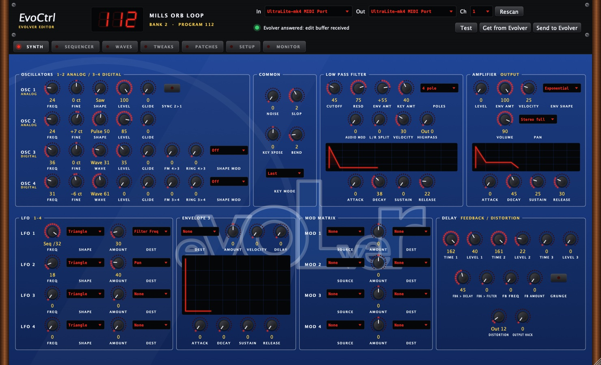
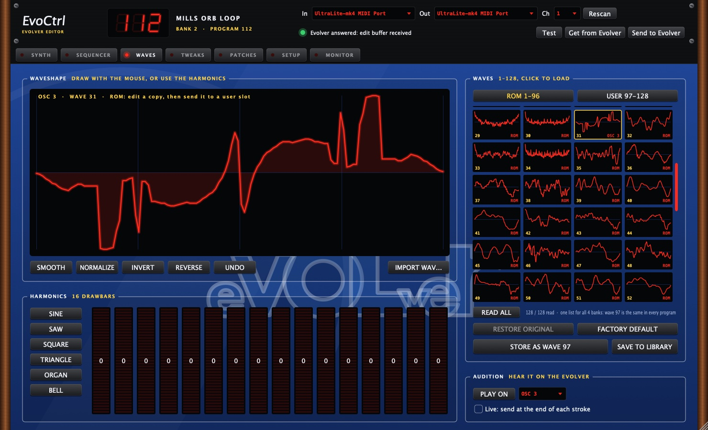

# EvoCtrl: Evolver editor and MIDI controller (VST3 / AU)

An editor and controller for the **Dave Smith Instruments Evolver (desktop, mono)**, as a **VST3 / AU** plug-in
and a standalone app. The whole synth sits on one panel and can be automated in Ableton Live. Sync works both
ways: turn a knob in the plug-in and the Evolver follows, turn a knob on the Evolver and the plug-in follows.

In short, it is an Evolver VST, an Evolver MIDI controller, an Evolver patch editor and librarian, and an Evolver
waveshape editor, all in one, for the DSI / Sequential Mono Evolver desktop module.

> **Tested on macOS only.** The Windows build has never been compiled or tested (see [Compatibility](#compatibility)).



- [Features](#features)
- [Compatibility](#compatibility)
- [Versions](#versions)
- [Installation](#installation)
- [Cabling](#cabling)
- [Evolver settings](#evolver-settings)
- [Ableton Live settings](#ableton-live-settings)
- [How to test](#how-to-test)
- [How the MIDI works](#how-the-midi-works)
- [The pages](#the-pages)
- [Where the data is kept](#where-the-data-is-kept)
- [Troubleshooting](#troubleshooting)
- [Known limitations](#known-limitations)
- [Development](#development)

---

## Features

| | |
|---|---|
| **Full editing** | All 128 parameters of a program on one page laid out like the Evolver's front panel: 4 oscillators, filter, amp, 3 envelopes, 4 LFOs, mod matrix, delay, feedback and distortion. |
| **Two-way sync** | Every change is sent to the Evolver in real time, and moves of its knobs come back into the plug-in. |
| **Automation in Live** | The 128 parameters are plug-in parameters: automation, MIDI Map, clip envelopes. |
| **4 × 16 sequencer** | Edit all 64 steps and their destinations; Start / Stop and Reset the Evolver's own sequencer. |
| **Waveshapes** | The Evolver's 128 waveshapes as thumbnails, with an editor (drawing, harmonics, WAV import) that writes to the 32 user slots. |
| **Evolver memory** | All 4 banks × 128 programs with their names; load a program, or write one. |
| **Local library** | Patches stored as `.syx` with name, tags and favourites; `.syx` import and export. |
| **Global settings** | The Evolver's Main menu (MIDI, Poly Chain, clock, transpose and so on), read and set from the plug-in. |
| **Saved with the set** | The patch, the sequence and the MIDI ports are stored in the Live set. |

---

## Compatibility

| Platform | Status |
|---|---|
| **macOS 11 or later** (Apple Silicon and Intel, universal binary) | ✅ Tested on an Apple Silicon Mac with Ableton Live 12, a MOTU UltraLite-mk4 and a desktop Evolver. VST3 and AU pass pluginval at strictness level 5. |
| **Windows 10 / 11** | ⚠️ **Not tested.** The code and CMake project are meant to build a Windows VST3, but it has never been compiled or run on Windows. The SysEx fix described below exists on macOS only. |
| **Linux** | ❌ Not tested. |
| **AU** | macOS only (it is an Apple format). |
| **Synth** | Tested on the **mono desktop Evolver** only. The Mono Evolver Keyboard should use the same messages, but this is not guaranteed. The **Poly Evolver** is not supported. |

There is no prebuilt download yet, so you need to build it yourself (see below).

---

## Versions

| Platform | Formats | Version | Status |
|---|---|---|---|
| **macOS** | VST3, AU, standalone | **0.1.0** (current `main`) | ✅ **Up to date.** Every feature in this README is in the build and has been tested on the hardware. |
| **Windows** | VST3, standalone | none | ⚠️ **Not up to date.** Never built, so none of the features have been checked. Progress is tracked in [#9](https://github.com/hillzeealex/evoctrl/issues/9). |

---

## Installation

### Building on macOS

You need Xcode or the Command Line Tools, CMake 3.22 or later, and Ninja (or use `-G Xcode`). JUCE 8 is downloaded
automatically.

```sh
cmake -B build -G Ninja -DCMAKE_BUILD_TYPE=Release
cmake --build build
ctest --test-dir build          # tests for the SysEx format and the parameter layout
```

The build is always universal (arm64 and x86_64). This is set in `CMakeLists.txt`, because an Intel Homebrew
`cmake` running under Rosetta would otherwise produce an Intel-only plug-in, which Live on Apple Silicon refuses to
load.

### Installing

```sh
cp -R build/EvoCtrl_artefacts/Release/VST3/EvoCtrl.vst3 ~/Library/Audio/Plug-Ins/VST3/
cp -R build/EvoCtrl_artefacts/Release/AU/EvoCtrl.component ~/Library/Audio/Plug-Ins/Components/
killall -9 AudioComponentRegistrar   # makes macOS rescan the AUs
```

In Live, go to *Settings → Plug-Ins*, switch on VST3 and/or Audio Units, then click *Rescan*.
**After every update, quit Live completely (Cmd+Q) and open it again.** Live keeps the version of the plug-in it
loaded at start-up.

The first time it runs, macOS asks for access to the **Documents** folder, where the library is kept. Allow it.

The standalone app (`build/EvoCtrl_artefacts/Release/Standalone/EvoCtrl.app`) lets you edit without Live.

### Building on Windows (not tested)

```bat
cmake -B build -G "Visual Studio 17 2022"
cmake --build build --config Release
```

Then copy `EvoCtrl.vst3` to `C:\Program Files\Common Files\VST3\`.

---

## Cabling

The desktop Evolver has **no USB**, only 5-pin DIN MIDI sockets. A MIDI cable only carries data one way, so you
need **two** of them for sync to work in both directions:

```
             MIDI OUT ───────────────► MIDI IN
 Interface                                       Evolver
 (UltraLite) MIDI IN  ◄─────────────── MIDI OUT

 Audio inputs 5/6 ◄────────────────── Left / Right audio outputs
```

| With only interface → Evolver | With both cables |
|---|---|
| Notes, plug-in knobs, automation, Send to Evolver, Write | **Everything**: also Test, Get, reading programs, names, waveshapes and global settings, and the Evolver's knob moves coming back |

A dual USB MIDI cable (one USB plug, two DIN plugs) also works, as long as it handles SysEx properly.

---

## Evolver settings

Set these once, on the second row of the Evolver's **Main** menu (press MAIN twice; each knob sets one value),
**or straight from EvoCtrl's SETUP page**:

| Knob | Setting | Value | Why |
|---|---|---|---|
| 2 | **Poly Chain** | **OFF** | Otherwise the Evolver repeats everything it receives on its output, which garbles its replies. |
| 5 | **MIDI Rec** | **ALL** | To receive parameters and dumps. |
| 6 | **MIDI Xmit** | **ALL** | To send knob moves (sync) and program changes. |
| 7 | **MIDI Channel** | ALL (or Live's channel) | Used for notes; SysEx has no channel. |

To lock the Evolver's sequencer, delays and synced LFOs to Live's tempo, set **MIDI Clock** to *MIDI clock in* on the
SETUP page and switch on *Sync* for the interface output in Live (see below).

---

## Ableton Live settings

### Preferences (*Link, Tempo & MIDI*)

For the ports of the interface connected to the Evolver:

| Port | Track | Sync | Remote |
|---|---|---|---|
| Input | On (optional) | Off | **Off** |
| Output | **On** (to play notes) | On if you want the Evolver to follow Live's clock | **Off** |

*Remote* set to Off stops Live's MIDI mappings from controlling the Evolver alongside EvoCtrl. On macOS, Live and
EvoCtrl can share the same port without any trouble.

### Tracks

- **"Evolver" track**: a MIDI track with an **External Instrument** (*MIDI To* = the interface output, *Audio From*
  = inputs 5/6). It plays the notes and brings the sound back, with latency compensation.
- **"EvoCtrl" track**: a MIDI track with the EvoCtrl plug-in. Pick the ports in the top bar, then click
  **Get from Evolver**. It does not need to be armed.

EvoCtrl makes no sound and does not pass notes on: it edits the sound. Notes go through the Evolver track.

### Automation

Live does not list all 128 parameters of a plug-in by default. To automate one, click **Configure** in the EvoCtrl
device header, then move the knob in the plug-in. It then shows up in Live, ready to automate or map.

---

## How to test

### Checking your setup (about two minutes)

With the cables plugged in and the [Evolver settings](#evolver-settings) done, open EvoCtrl (the standalone app is
the quickest) and go through these steps in order. If a step fails, the ones after it will fail too.

| # | Do this | You should see |
|---|---|---|
| 1 | Pick the interface in **In** and **Out** | "Ports open - press Test to check the Evolver answers" |
| 2 | Click **Test** | Green light and "Evolver connected and answering". The display shows the Evolver's bank and program. |
| 3 | Click **Get from Evolver** | "Edit buffer received from the Evolver", and the knobs jump to the Evolver's current sound |
| 4 | Turn **Cutoff** in the plug-in | The Evolver's display and sound follow. The value must not get stuck on 17 (see [#1](https://github.com/hillzeealex/evoctrl/issues/1)). |
| 5 | Turn a knob on the **Evolver** | The same knob moves in the plug-in |
| 6 | Change program on the Evolver | The plug-in reloads the new sound and shows the new number |
| 7 | Open **MONITOR** and tick the log box, then move a knob | OUT lines for knobs moved in the plug-in, IN lines for knobs moved on the Evolver |

Steps 2, 3, 5 and 6 need the return cable (Evolver OUT to interface IN). If they fail, see
[Troubleshooting](#troubleshooting).

### Testing on Windows

Windows has never been tested, so any report helps. Build it as described in
[Building on Windows](#building-on-windows-not-tested), go through the table above, and post what happened in
[#9](https://github.com/hillzeealex/evoctrl/issues/9): your Windows version, your MIDI interface, the step that
failed and what the MONITOR page showed. Step 4 matters most, because the fix for the cutoff problem exists on macOS
only.

### Automated tests

`ctest --test-dir build` runs the tests for the SysEx format and the page layout, and pluginval checks the plug-in
itself (see [Development](#development)). Neither needs an Evolver.

### What has been tested

**Automated tests** (`tests/SysexTests.cpp`, run on every build):

| Test | What it checks |
|---|---|
| Packing | 192 bytes pack to 220 and 256 to 293, as the manual states; unpacking gives the original bytes back; every packed byte is below 0x80; the bit layout matches the manual |
| Messages | Exact bytes of Program Parameter, Request Edit Buffer, Request Program, Main Parameter, Request Main Dump, Start/Stop, Reset and Request Waveshape |
| Dumps | Edit buffer and program dumps survive a round trip, including the bank, program and all 64 steps |
| Names | Names survive a round trip; an unnamed program (filled with 0x7F) reads as empty |
| Main dump | Program, bank and the other global settings are read from the right nibbles |
| Waveshapes | A wave dump is 300 bytes and all 128 16-bit points survive a round trip; a truncated dump is rejected |
| Bad input | Messages from other manufacturers and truncated dumps are rejected; a `.syx` file with junk between messages is split correctly |
| Parameter table | Every default value is within range, and every value of every parameter has display text |
| Layout | Each of the 128 parameters has exactly one control in the editor, and every envelope graph points at an Attack to Release group |

**Plug-in validation** on macOS: pluginval at strictness level 5 on the VST3 and the AU after every change, and auval
on the AU. Both binaries are universal (arm64 and x86_64).

**On the hardware** (desktop Evolver behind a MOTU UltraLite-mk4, Apple Silicon Mac, Ableton Live 12). Most of these
were run by driving the standalone app from CoreMIDI scripts, which uses the same code as the plug-in. The current
sound was backed up first and restored afterwards.

| Test | Result |
|---|---|
| Connection, Test, Get from Evolver | ✅ Answers, and the current bank and program are read |
| All 128 parameters sent from EvoCtrl, then read back from the Evolver | ✅ Every value correct |
| All 64 sequencer steps, same method | ✅ Every value correct |
| Send to Evolver, then read back | ✅ Identical, no difference |
| Cutoff values 79, 33, 150 and 64 from the plug-in | ✅ All stored correctly (they were all 17 before the fix in [#1](https://github.com/hillzeealex/evoctrl/issues/1)) |
| The same SysEx split into two packets | ❌ Misread as 17 every time, which is how the cause of #1 was found |
| Spacing between messages | 1 ms: 1 or 2 messages lost per burst, in every run. 4 ms: no errors in 4 runs (768 messages). See [#2](https://github.com/hillzeealex/evoctrl/issues/2). |
| Parameter echo | The Evolver echoes every parameter it receives; EvoCtrl ignores the echo ([#3](https://github.com/hillzeealex/evoctrl/issues/3)) |
| Edit buffer dump while a name is requested | Truncated to 219 and 176 bytes instead of 226 before the fix in [#4](https://github.com/hillzeealex/evoctrl/issues/4); complete since |
| Cutoff moved from the plug-in in Live | ✅ Heard on the Evolver |
| A knob turned on the Evolver | ✅ The same knob moves in the plug-in |
| Program changed on the Evolver | ✅ EvoCtrl reloads the sound and shows the new number |
| Reading all 128 waveshapes | ✅ 128 of 128 read (one wave missed its reply on the first run, hence the retry) |
| A test wave written to slot 128, then read back | ✅ Identical to the bit; the original was written back, also identical |
| Reading the global settings | ✅ All values shown match the Evolver |
| Changing a global setting (Master Volume), then setting it back | ✅ Both applied |
| Switching program through Main parameters 1 and 0 (from a script) | ✅ The Evolver switched, and the edit buffer was restored afterwards |
| Program names | ✅ Bank 3 names read and shown |

**Not tested yet**

- **Windows**, in any form ([#9](https://github.com/hillzeealex/evoctrl/issues/9)).
- **WRITE HERE…**, on purpose, because it overwrites a program in the Evolver's memory
  ([#11](https://github.com/hillzeealex/evoctrl/issues/11) covers the name).
- **LOAD ON EVOLVER** from the button (the same messages worked from a script).
- **Start / Stop** and **Reset** of the sequencer (the messages match the manual).
- **WAVES following the program** on the hardware (checked with two simulated program changes, to waves 70 and 20,
  without the Evolver).
- `.syx` import and export, automation recorded in Live, and *Via Ableton* mode
  ([#10](https://github.com/hillzeealex/evoctrl/issues/10)).
- Other DAWs than Ableton Live, other MIDI interfaces than the UltraLite-mk4, and the Mono Evolver Keyboard.

---

## How the MIDI works

### SysEx, not NRPN or CC

The Evolver manual (v3.2a) documents **no NRPN at all**. The Evolver exchanges its parameters as **SysEx** (system
exclusive messages specific to DSI), so these are the messages EvoCtrl uses:

| Message | Direction | Used for |
|---|---|---|
| Program Parameter `0x01` | ↔ | One sound parameter (real time, both ways) |
| Sequence Parameter `0x08` | ↔ | One sequencer step |
| Main Parameter `0x09` | → | One global setting (SETUP page, program change) |
| Request / Edit Buffer `0x06` → `0x03` | ↔ | Reading (Get) or sending (Send) the current sound |
| Request / Program Dump `0x05` → `0x02` | ↔ | Reading or writing a program in a bank |
| Request / Name `0x10` → `0x11` | ↔ | Program names |
| Request / Main Dump `0x0E` → `0x0F` | ← | Global settings, current bank and program |
| Request / Waveshape `0x0B` → `0x0A` | ↔ | Waveshapes (128 points, 16-bit) |
| Start/Stop `0x12`, Reset `0x04` | → | The Evolver's sequencer transport |
| Program Change | ← | The Evolver has changed program, so EvoCtrl reloads the sound |

The full specification, with page numbers from the manual, is in
[docs/evolver_midi_spec.md](docs/evolver_midi_spec.md).

### Why EvoCtrl opens the MIDI ports itself

Live does not reliably pass on SysEx sent by a plug-in. So EvoCtrl opens the interface ports directly (chosen in the
top bar) and sends its messages without going through Live. This is **Direct** mode, the default and the
recommended one.

**Via Ableton** mode (SETUP page) sends **CCs** on the plug-in's MIDI output instead, for the ~40 parameters that have
a documented CC. It is experimental: the CC scaling has not been checked on the hardware, and dumps, waveshapes and
names cannot go this way.

### What makes the sync reliable

All of this was checked on a real Evolver:

- **One message, one packet.** On macOS, JUCE 8 goes through the MIDI 2.0 API, which splits every SysEx into 6-byte
  chunks. Behind the interface, the Evolver misread those split messages (the cutoff always landed on 17). EvoCtrl
  therefore sends each message in one piece through the classic CoreMIDI API.
- **At least 4 ms between messages.** At 1 ms the Evolver lost 1 or 2 messages per burst. At 4 ms (roughly the speed
  of a MIDI cable) nothing was lost. EvoCtrl only sends the latest value of a knob, so there is no noticeable lag.
- **No echo.** A value received from the Evolver updates the plug-in without being sent back. Values that come back
  shortly after a send (within 400 ms) are ignored, so a knob is not pulled back while you are turning it.
- **One request at a time.** Long reads (128 waveshapes, 128 names) happen one by one, each after the previous reply,
  with a retry if nothing comes back. A request sent while the Evolver is replying would corrupt its reply.
- **Only its own replies.** If two copies of EvoCtrl are open (plug-in and standalone app), each ignores the replies
  the other one asked for.

### Why SysEx is slower than CC, and why that was not the "17" problem

A 5-pin MIDI cable runs at 31,250 bits per second, which is about 3,125 bytes per second, or 0.32 ms per byte. So the
size of a message sets how fast it can travel:

| Message | Size | Time on the cable | Most per second |
|---|---|---|---|
| CC (Via Ableton mode) | 3 bytes | about 1 ms | about 1,000 |
| Program Parameter SysEx (Direct mode) | 9 bytes | about 2.9 ms | about 340 |
| Same, with EvoCtrl's 4 ms spacing | 9 bytes | 4 ms | 250 |
| Whole patch (Send to Evolver, one edit buffer dump) | 226 bytes | about 72 ms | |
| All 128 parameters sent one by one | 1,152 bytes | about 0.5 s | |

A CC is three times smaller, so in theory it is faster. In practice it does not help much: only about 40 parameters
have a CC, a CC only has 128 steps where the cutoff has 165, and the Evolver itself drops messages that arrive less
than about 4 ms apart, whatever their type. A knob turned quickly does not build up a backlog either: EvoCtrl only
sends its latest value.

The cutoff landing on 17 looked like a speed problem, but it was not. Even a single knob move, one message on its own,
landed on 17, while the plug-in's log showed the right bytes going out and a test script sending the same bytes
worked at every speed tried. The real cause was
that macOS split each 9-byte message into two packets on its way to the interface, and the Evolver misread the split
message. Sending each message as one packet fixed it at full speed (see
[#1](https://github.com/hillzeealex/evoctrl/issues/1)). The 4 ms spacing is a separate fix, for the messages lost in
fast bursts ([#2](https://github.com/hillzeealex/evoctrl/issues/2)).

---

## The pages

**Top bar** (on every page): In / Out ports, channel, **Test** (checks that the Evolver answers, without changing
anything), **Get from Evolver** (loads the current sound), **Send to Evolver** (sends the whole patch). The status
light shows green for OK, yellow while waiting and red for an error. The LED display shows the program number, then
for about 2 seconds the value of the last parameter moved, whether by mouse, automation or a knob on the Evolver.

- **SYNTH** (picture at the top): the whole sound on one page, laid out like the Evolver's front panel. LED ring
  knobs (lit from the centre for bipolar values), menus for lists, LED buttons for on/off, envelope graphs.
  **Double-click** for the default value, **Cmd-drag** for fine adjustment, and the mouse wheel works too.
  Hovering shows the parameter number, its range and its CC. The page scales with the window.
- **SEQUENCER**: the 4 sequences of 16 steps (0-100; 24 is one octave on an oscillator), their destinations, trigger
  mode, clock divide, tempo, **Start / Stop** and **Reset**.
- **WAVES**: see below.
- **TWEAKS**: velocity, mod wheel, pressure, breath, foot pedal, and the external audio input.
- **PATCHES**: the Evolver's **4 banks × 128 programs** with their names (**LOAD ON EVOLVER** switches the Evolver
  to that program, **WRITE HERE…** writes the current sound there after you confirm), your local library (search,
  tags, favourites) and `.syx` import and export.
- **SETUP**: the Evolver's global settings, read each time the page opens (a red banner flags anything that stops
  EvoCtrl from working), and EvoCtrl's own settings (MIDI path, interval between messages, resending the patch
  when the set opens).
- **MONITOR**: a hex log of the messages sent (OUT) and received (IN). This is the first place to look when something
  does not get through.

### WAVES



The **128 waveshapes** of the digital oscillators (3 and 4). There is a single list, shared by all 4 banks: wave 97 is
the same in every program.

- **ROM 1-96**: factory waveshapes, read-only (you can edit a copy).
- **USER 97-128**: your own slots, writable.
- The page opens on the wave that Osc 3 (or 4) of the current program plays, and follows when you change program.
  **UNDO** brings back an edit in progress.
- Draw with the mouse, use the **16 harmonic drawbars** or the starting shapes, apply Smooth / Normalize / Invert /
  Reverse, or **import a single-cycle .wav**.
- **STORE AS WAVE n** writes the wave to a user slot (asking first if the slot holds something else). **PLAY ON**
  selects it on Osc 3 or 4 so you can hear it.
- **RESTORE ORIGINAL** puts back what the slot held before EvoCtrl first wrote to it. **FACTORY DEFAULT** puts back the
  factory wave: the Evolver ships with waves 97-128 identical to waves 1-32.
- In **Live** mode the wave is sent at the end of each stroke rather than continuously, because the Evolver writes
  every wave it receives to its permanent memory.

The first read of all 128 waves takes about fifteen seconds; after that they are kept on disk.

---

## Where the data is kept

Everything lives in `~/Documents/EvoCtrl/`:

| File | Contents |
|---|---|
| `Library/*.syx` + `library.json` | Your patch library (one `.syx` per patch, readable by any SysEx tool) with its tags and favourites |
| `Waves/evolver-cache.syx` | The 128 waveshapes read from the Evolver |
| `Waves/originals.syx` | Your 32 user waves as they were before EvoCtrl first wrote to them |
| `Waves/*.syx` | Waves saved with *Save to library* |
| `program-names.syx` | The program names of all 4 banks |

---

## Troubleshooting

| Symptom | Likely cause and fix |
|---|---|
| **"No (complete) answer from the Evolver"** | The Evolver OUT → interface IN cable is missing or swapped; MIDI Xmit is not set to ALL; Poly Chain is not set to OFF. |
| **The ports do not appear** | The Mac cannot see the interface: check the USB cable, then *Audio MIDI Setup → MIDI Studio*. Then click *Rescan* in EvoCtrl. |
| **A change in the plug-in has no effect on the Evolver** | Open MONITOR: OUT lines should appear. If they do not, the output port is the wrong one. |
| **Nothing changes after an update** | Live is still running the old version: quit it completely (Cmd+Q) and open it again. |
| **Everything sounds higher or lower than expected** | The Evolver's Master Transpose is not 0: set TRANSPOSE back to 0 on the SETUP page. |
| **The delay or synced LFOs do not follow Live** | Set MIDI Clock to *MIDI clock in* on the SETUP page and switch on *Sync* for the interface output in Live. |

---

## Known limitations

- No Windows or Linux testing so far.
- No NRPN (not in the manual): SysEx in Direct mode, CCs as an option.
- *Via Ableton* mode: CC scaling not checked, only ~40 parameters.
- The name sent with *Write* uses a documented message, but the manual does not say whether the Evolver keeps it.
- The numeric codes of the sequencer's "rst" and "off" steps are not documented; EvoCtrl keeps them as they are.
- Glide "fingered" mode (values 101-199) is not precisely documented.
- Default parameter values (double-click) are neutral values chosen by EvoCtrl, as the manual gives none.
- EvoCtrl does not play notes or process the Evolver's audio.

---

## Development

```
Source/
  EvolverParams.h     table of the 128 parameters (name, range, display, CC): the single source
  EvolverSysex.h      SysEx encoding and decoding, no JUCE dependency (tested)
  EditorLayout.h      page layout (tested: every parameter placed exactly once)
  EvolverLink.*       direct MIDI ports, paced send queue, one-packet CoreMIDI send on macOS
  PluginProcessor.*   host parameters, sync, reads (waves, names, globals), set state
  PluginEditor.*      user interface (Evolver look and feel, pages)
  PatchLibrary.*      patch library on disk
tests/SysexTests.cpp  tests for the SysEx format and the layout
docs/evolver_midi_spec.md   MIDI specification taken from the manual, with page numbers
```

- Tests: `ctest --test-dir build`.
- Validation: `pluginval --strictness-level 5 --validate-in-process ~/Library/Audio/Plug-Ins/VST3/EvoCtrl.vst3`.
- C++20, JUCE 8.0.12 (downloaded by CMake).

---

*Evolver, Dave Smith Instruments and Sequential are trademarks of Sequential LLC. EvoCtrl is a personal project
with no connection to Sequential.*
